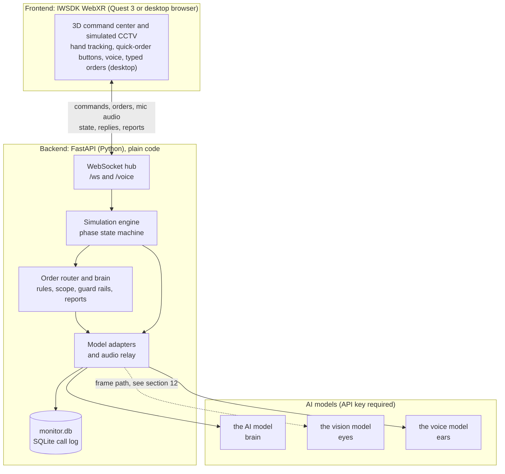
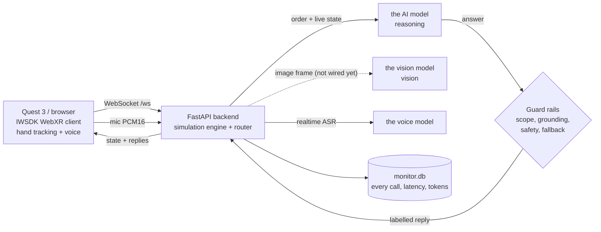

# Qubro Next-Gen Spatial Command & Control Center (CCC)

**Live app:** https://lordarris2025.github.io/-qubro-spatial-ccc-/app/ · **Demo video:** https://youtu.be/LlkcGd_Jt8k · **Source:** kept in a private repository (available to the organisers on request) · **For judges:** [JUDGES.md](JUDGES.md)

**Scan with your Quest** (no typing in the headset):

https://lordarris2025.github.io/-qubro-spatial-ccc-/app/

Short name: **Qubro**. A hands-only WebXR command center for a data-center security team, built with **IWSDK** for **Meta Quest 3** and powered by **the AI model**, **the vision model** and **the voice model**. You stand inside a virtual Command Control Centre, speak or type an order, and four sector AIs (cyber, drones/robots, LiDAR/orbital, CCTV/doors) answer from the **live state** of the building. Countermeasures can only be authorized by a hand gesture, never by voice or by the model.

**Key features**

- **The Commander:** your role, a fictional human-metal hybrid director who oversees the command center. Nobody real is named or depicted.
- **Qubro AI Assistants:** four multi-colour sector AI avatars (cyber, drones and robots, LiDAR and radar, CCTV and doors); the AI model reasons over each order together with the live state.
- **Threat detection:** the vision model is integrated for camera frames. In this build the L34 vault frame is not yet sent to it, so the detection (units, confidence) is a labelled simulation and the monitor records it as `simulated`; see [known limitations](docs/ARCHITECTURE.md#12-known-limitations).
- **Red alert and vision confirmation:** during the simulated intrusion a flashing RED ALERT banner and a siren run until the threat is neutralized. SAM 3.1 boxes the spiders in red on the L34 CCTV feed and in the battle hologram, and a panel shows its five steps (frame in, segment, classify, verdict, hand off). The detection numbers are a labelled simulation; only the Commander's hand authorizes.
- **Hands-first, end to end:** in the headset every action is done with your hands. Bring a fingertip near a desk button and it lights up (hover only highlights); **pinch it, pull it away like stretchy plastic, then let go** to activate it: start the simulated intrusion, lock the doors, talk to the Core AI, or ask one of the six QUICK ORDER questions (there is no virtual keyboard and no microphone is needed). A small dot shows where your hand pinches, a glowing rubber sheet stretches from the button to your fingers, the hint counts PULL [###--] up to LET GO!, and letting go selects it: the button floats up, glowing, and a voice says "Your choice: ..."; one second later the command runs by itself (pinch, pull, let go is the whole decision: no second confirm pull, with sounds). On a computer, press and hold the mouse on a button, drag, release. Pinch and pull AUTHORIZE INTERCEPT to authorize the countermeasures. Voice and the model can never authorize.

## Documentation

Everything a reviewer needs is in [`docs/`](docs/README.md):

| Document | What it covers |
|---|---|
| [COMPLIANCE.public.md](COMPLIANCE.public.md) | Contest rule to evidence table, with the items that are still pending |
| [docs/ARCHITECTURE.md](docs/ARCHITECTURE.md) | System design: components, architecture diagrams, runtime flows (attack lifecycle, order to answer, reports, voice), how the three AI models are used, safety rules, failure modes, known limitations |
| [docs/USER_GUIDE.md](docs/USER_GUIDE.md) | **How to use Qubro in VR** (Quest 3 or desktop): the room, hand gestures, keys, voice and typed orders, a three-minute tour, reading the labels, troubleshooting |
| [docs/API.md](docs/API.md) | REST endpoints, `/ws` and `/voice` WebSocket protocols, message formats |
| [docs/images/](docs/images/) | Static diagram images: [architecture](docs/images/architecture.png), [models](docs/images/models.png), [intrusion lifecycle](docs/images/attack-lifecycle.png), [intrusion sequence](docs/images/attack-sequence.png), [order pipeline](docs/images/order-pipeline.png) |
| [PRIVACY.md](PRIVACY.md) | What data the app handles, what it keeps and what it does not do |
| [eval/RESULTS.md](eval/RESULTS.md) | Offline evaluation of the order router (74 labelled orders) |

New here? Read the [user guide](docs/USER_GUIDE.md) first, then [ARCHITECTURE.md](docs/ARCHITECTURE.md) sections 1 to 5, then [API.md](docs/API.md).

## Competition entry

Built for the **Meta VR Start Developer Competition: Contest 2026**. Track: **Productivity**. Division: **New Experience**. Conceived of and built within the competition window, after 24 September 2026. No earlier codebase is reused (public libraries and SDKs only; see [THIRD_PARTY.md](THIRD_PARTY.md)). Hands-first, seated, and playable end to end without a controller.

## Design standards: the four tests

The organisers' requirement and guidelines, each with the test they give and our answer:

| Requirement | Standard | The Test | Qubro's answer |
|---|---|---|---|
| **Requirement** | | | |
| Hands-first | Fully usable with hands end-to-end. Controller support optional. | Can someone complete the entire experience without ever pairing a controller? | **Yes.** The VR session requires hand tracking and no code reads a controller button; controller models and rays are switched off and a notice asks the person to put a real controller down. Every action is a hand pinch-and-pull on a desk button. Typing uses an in-scene touch keyboard; voice is optional. *Tested in an XR emulator; not yet measured on physical Quest hardware.* |
| **Guidelines** | | | |
| Seated-optimized | Designed for seated/stationary use. Limit roomscale or large physical movement. | The "airplane seat test": does every interaction work in a 2 ft radius? | **Yes.** The room is laid out for a seated eye at about 1.25 m. All controls sit on one desk inside a 0.6 m (about 2 ft) reach (farthest button row about 0.53 m). No locomotion or teleport. The tower, report and battle holograms are read-only: nothing is touched at distance. *Distances are from the design and code, not measured on a headset.* |
| Easy to get into/out of | Fast cold start. Clean pause/resume. Satisfying in 10 minutes or less. | The "one bus stop test": can someone have a complete moment in a short ride? | **Yes.** One link, no install, no login. ENTER VR, then simulate an intrusion, authorize and one QUICK ORDER is a complete moment in about a minute. RESET gives a clean start; leaving VR and re-entering restores the desk. An offline demo runs if the backend cannot be reached. *The free backend can need up to a minute to wake on the first visit.* |
| Original, not a wrapper | Core experience is Entrant-built. Thin wrappers around existing platforms or services (YouTube, ChatGPT, etc.) are highly discouraged. | The "take it away test": remove the third-party service. Is there still a Project? | **Yes.** Without the hosted models there are still about 7,300 lines of TypeScript (WebXR client) and about 2,500 lines of Python (phase state machine, order router, guard rails, monitor, per-visitor sessions), a router scored 98.6 % on 74 labelled orders, and a labelled fallback for every model answer. The authorize decision is always a hand gesture. *Free-form answers, written reports and voice orders need the hosted models.* |
| Field of view (judging note) | Evaluators look for FoV-aware design: essential UI inside a comfortable, narrower FoV. | Is essential UI comfortable on Meta VR devices with different fields of view? | **Designed for it, not yet tested on other devices.** The answer bubble sits about 38 degrees left and slightly above eye level; the tower hologram is straight ahead and the report hologram about 36 degrees right, all inside a comfortable central view. The desk controls are below eye level, so you look down at your hands as at a real desk. The four sector screens spread further round the room and are read by turning your head; no control lives on them. *Angles come from the code, not from measurement on a headset.* |

More answers for reviewers: the **Meta Code of Conduct** and **Content Guidelines** tables are in [JUDGES.md](JUDGES.md#meta-code-of-conduct-for-virtual-experiences), data handling is in [PRIVACY.md](PRIVACY.md), and the rule-by-rule evidence is in [COMPLIANCE.public.md](COMPLIANCE.public.md).

## For judges: how to open it (headset or no headset)

**You do not need a headset.** Open the live link (HTTPS, no login, no install) and pick the option that matches what you have. A full walkthrough is in the [user guide](docs/USER_GUIDE.md#2-start-it).

| You have | What to do | What you get |
|---|---|---|
| **Meta Quest 3 or 3S** (best experience) | Open the live link in the **headset browser** inside the headset. Turn **hand tracking on** (Settings > Movement tracking). Press **ENTER VR (hands only)** on the page. The browser's own "Enter VR" offer is switched off on purpose, so use the page button. | The full immersive command room with 3D hands. No controllers. |
| **Any computer, nothing to install** | Open the live link in desktop **Chrome or Edge**. Drag the mouse to look around, click the desk buttons, or press `1` (simulate intrusion), `2` (authorize), `3` (reset). The key list is on the page. | The same room, on a flat screen. Everything in the demo is reachable. |
| **Computer, and you want to enter VR** | Press **ENTER VR (hands only)**. Since v129 the built-in Quest 3 emulator is part of the hosted page on desktop browsers, so nothing needs installing. (The Meta *Immersive Web Emulator* Chrome extension also works.) | A virtual Quest 3 on your computer. |

What to try in about two minutes: press **SIMULATE INTRUSION**, wait for the log line "Awaiting the Commander's Hand Authorization", then authorize (pinch and pull AUTHORIZE INTERCEPT in VR, key `2` or a click on the desktop), then touch a **QUICK ORDER** button. **Not sure what to ask the AI?** Press **GUIDE / HELP** (a desk button in VR, key `H` on a computer): it shows what to ask each of the four AIs (for example "Cybersecurity status?", "What is the satellite status?", "Show me CCTV").

#### Meta Quest step by step (headset)

**Devices:** Meta Quest 3 or 3S (the app is built and tested for these). Smart glasses without WebXR cannot run it.

1. **Turn on hand tracking:** Quest Settings > Movement tracking > Hand and body tracking. The app requires it and needs no controllers, so put the controllers down.
2. **Open the headset browser** in the headset and go to the live link. Typing in a headset is slow: scan the QR code on the Devpost page with the Quest, or use a short link.
3. **Press ENTER VR (hands only) on the page.** The browser's own "Enter VR" offer is switched off on purpose, so this page button is the way in. Accept any permission prompt (the microphone is only needed for voice orders).
4. **You are now in the command room**, seated at the desk with your 3D hands in front of you.
5. **Pinch and pull** a desk button or a QUICK ORDER button: bring your index fingertip near it (it lights up, that alone does nothing), pinch it (thumb tip to index tip) and pull it away about 3 cm like stretchy plastic until the hint says LET GO!, then let go: it activates. Let go early and it springs back with nothing sent. With a mouse: press and hold on the button, drag, release. **Point and pinch** (thumb tip to index tip) for the buttons under the answer bubble and on the report and monitor panels.
6. **Run the demo:** pinch and pull SIMULATE INTRUSION, wait for the log line "Awaiting the Commander's Hand Authorization", then pinch and pull **AUTHORIZE INTERCEPT** (next to it on the desk) to authorize the interceptors.
7. **To leave VR,** use the Quest menu button or the browser's exit; the page returns to the flat view.

Notes: only full VR is offered (passthrough and spatial anchors are not used). The hosted link connects to the backend (hosted on Render) when it is awake and reachable; each visitor gets their own simulation. If the backend cannot be reached the page falls back to offline demo mode, and live AI answers and voice need the backend. If tracking is lost, hold both hands in front of you so the cameras can see them.

**Performance (honest status).** Tested in the IWSDK XR emulator on a development laptop, where the scene held 60 FPS in the latest runs, with no dips. Not yet measured on a physical Quest 3 (the emulator's number is the laptop's, not the headset's). An FPS meter is built in but hidden by default (the small panel on the desk; add `?fps=1` to the address to show it).

**Voice and privacy.** Spoken orders are sent for transcription and are not stored: the backend relays the audio in memory to the speech-to-text service and writes no audio to disk (only a byte count and the transcript text appear in the call log). If no voice service is configured, the browser's own speech recognition is used instead, which is handled by the browser vendor.

**Recording a video of the emulator.** The emulator draws its own panels ("Controller [L]/[R]", "Quest 3" device panel). They belong to the emulator, not to Qubro, and Qubro itself has no controller UI. When you record, hide those panels (close the emulator side panel) or say in the video that they are the emulator.

**Live link mode.** The hosted link connects to the backend on Render when it is awake. The free tier sleeps when idle, so the first visit can take up to one minute; until it answers (or if the link drops) the page runs the **offline demo**: the simulated intrusion scenario, logs, CCTV, hologram and authorization all work and the demo can still give a **template** after-action report when READ REPORT is touched labelled FALLBACK TEMPLATE. The AI model answers, vision model and voice orders need the backend and are shown as "BACKEND NOT CONNECTED". Every AI answer carries a label saying who wrote it (see the user guide, section 7). Everything in the scene is simulated; no real system is touched. The on-screen AI labels are neutral (AI BRAIN, AI VISION, AI VOICE); the models behind them are named in the disclosure below.

**AI models used (disclosure).** The hosted models are Meta's: Muse Spark 1.3 (answers, plans, reports), SAM 3.1 (vision; the demo detection is a labelled simulation) and Muse Voice (speech-to-text). They were used through normal developer access, with no private invitation. The names appear in documents; the on-screen text and the tour use generic names (AI model, vision model, voice model), with one exception since v228: the vision layer on the battle hologram labels its spider tags "SAM 3.1" (still a labelled simulation; the constant `SHOW_MODEL_NAME` in `frontend/src/battle3d.ts` switches it back to the generic name).

## Links

| | |
|---|---|
| Demo video (YouTube, under 3 minutes) | **https://youtu.be/LlkcGd_Jt8k** (the YouTube video is the official copy; the large original file is not in this repository) |
| For judges: criteria and where the evidence is | [JUDGES.md](JUDGES.md) |
| Rule-by-rule compliance table (rule to evidence, with what is still pending) | [COMPLIANCE.public.md](COMPLIANCE.public.md) |

> The live app runs in **offline demo mode** only while the backend is asleep or cannot be reached, so judges can try it immediately with mouse and keyboard, with a Quest 3 headset, or in desktop Chrome with the Immersive Web Emulator extension.

## The problem

Security operators in a data center watch many unrelated screens at once (CCTV, door access, network alerts, drones, LiDAR). During an incident the operator loses seconds switching between tools, and an AI assistant that answers from memory instead of from the live system can be dangerously wrong. This project puts all sectors in one immersive room, lets the operator ask in plain English or Malay, and forces every AI answer to be **grounded in the live state** with hard safety rails: the model can explain and recommend, but only the operator's hand can authorize an action.

## Inspiration

After 15 years as an IT Director in command control centres, I know the walls of CCTV, door access and network alerts, and the seconds operators lose jumping between tools. Spatial computing can put every screen in one workspace, reached with your hands. My worry with AI assistants is that they answer from memory, not from the live system, which is dangerous in security work. Qubro is an operations workspace where the AI answers from live state and can never act on its own.

## How I built it

Conceived of and built within the competition window, after 24 September 2026. The source code (client and backend) is kept in a private repository. The public repository holds only the documentation and the compiled, minified build of the app (folder `app/`, no source files and no source maps); the live link above serves that same build. The backend runs as a hosted service on Render, which is why the free tier can need up to a minute to wake.

- **Client:** IWSDK, TypeScript, three.js, Vite and direct hand tracking; desktop testing with the IWSDK Quest 3 emulator. The scene is fully procedural (no downloaded models).
- **Backend:** FastAPI and WebSocket, the simulation engine and a bilingual (English and Malay) order router.
- **AI:** the AI model reasons over each order; the voice model does speech-to-text (sent for transcription, not stored by Qubro); the vision model is integrated for camera frames, but the demo detection is a labelled simulation.
- **Guard rails:** off-topic orders are refused, every number must exist in the data sent, voice and the model can never authorize, and a labelled fallback mode runs without any model.
- **Testing:** 87 backend tests.

## What's next

Real log and camera sources through the syslog interface, a multi-operator mode, and measuring and tuning performance on physical Quest hardware (so far only the IWSDK XR emulator on a laptop has been used).

**Target launch date: 18 November 2026** (the live app, free). A store release can follow after the competition.

## How it works

Full architecture, flows and diagrams: [docs/ARCHITECTURE.md](docs/ARCHITECTURE.md). Compact view:

1. The headset (or desktop browser) sends the order; voice goes to the voice model for transcription.
2. The backend attaches the live state (phase, detection, plan, sector status, last log lines) and asks the AI model.
3. `backend/brain.py` checks the answer: in scope, every number exists in the context we sent, never claims an action the phase does not allow. A failed check or a slow call falls back to a fixed template, and the reply is **labelled** MUSE / FALLBACK / RULE on screen.
4. Every the AI brain, the vision model and the voice model call is logged (state, latency, tokens, errors) and shown in an in-VR monitor panel (press N, or the AI monitor opens after TEST AI LINKS; there are no external web pages).

## Models and tools used

| Component | Role |
|---|---|
| IWSDK 1.0.1 (`@iwsdk/core`) | WebXR scene, hand tracking, Quest 3 emulator for desktop |
| the AI model | Reasons over each order plus live state; writes answers and post-incident reports |
| the vision model | Segments hostile mechanical geometry in a camera frame. Adapter and link probe are live; the detection during the demo attack is a labelled simulation until the vault frame is wired in ([details](docs/ARCHITECTURE.md#12-known-limitations)) |
| the voice model (realtime ASR) | Speech-to-text for spoken orders |

API access: create an API key on the model provider's developer platform and put it in `backend/key.json` (`meta_api_key`) or the `META_API_KEY` environment variable. Without a key the app runs in simulation mode and says so.

## Try it (about 1 minute)

Nothing to install and nothing to build. Open the live app: https://lordarris2025.github.io/-qubro-spatial-ccc-/app/

1. Wait until the **AI Core** label says **ONLINE** (the free backend can need up to one minute to wake up).
2. In a Quest 3 / 3S browser: turn on hand tracking, then press **ENTER VR (hands only)**. On a computer: use Chrome or Edge, press **ENTER VR (hands only)** for the built-in virtual Quest 3, or just use the mouse and keys.
3. Press `1` (attack), then `2` (authorize), then touch a **QUICK ORDER** button.

Full controls (hands, keyboard, voice, typed orders) are in the [user guide](docs/USER_GUIDE.md).

## Hosting

- **App:** static files on GitHub Pages (this repository, folder `app/`).
- **Backend (AI answers and voice):** a hosted service on Render. It sleeps when idle, so the first visit can take up to one minute. If it cannot be reached, the page falls back to an offline demo and says so.
- Both stay online until the winners are announced (about 11 Dec 2026).

## Evaluation

`python3 eval/routing_eval.py` scores the deterministic order router on 74 hand-labelled English / Malay orders (see `eval/RESULTS.md`):

| Metric | Result |
|---|---|
| Sector routing accuracy | 98.6 % (73/74) |
| Macro F1 | 0.985 |
| Authorize-word safety flag | 100 % (74/74) |
| Router latency p50 / p95 | 0.023 ms / 0.040 ms |

The one miss is listed in `eval/RESULTS.md`. Live the AI model latency, tokens and error counts are measured by the in-app monitor, not by this offline test.

## Tests and checks

The test suite, the evaluation script and CI live in the private source repository: 87 backend tests (router, guard rails, monitor, voice, adapters) and a frontend build run on every push. The offline routing results are in [eval/RESULTS.md](eval/RESULTS.md).

## Safety design

- Voice and the model can **never** authorize or fire a countermeasure; the fixed sentence "only your hand can authorize" is always added.
- Doors move only on explicit lock / release phrases, with fixed wording.
- Off-topic orders get a fixed refusal; the AI Core only talks about this command center.
- Every number in a model answer must exist in the context we sent, otherwise the template fallback is used and labelled.
- All feeds and intrusions are **simulated**; no real systems are touched.

## Repository layout (this public repository)

    app/       the compiled static build of the live app (no source files, no source maps)
    docs/      USER_GUIDE.md, ARCHITECTURE.md, API.md, LIVE_APP_FOR_JUDGES.md, diagram images, live-app QR code
    eval/      RESULTS.md (offline routing evaluation)
    JUDGES.md, COMPLIANCE.public.md, LICENSE, THIRD_PARTY.md, project-manifest.json

## License

MIT, see `LICENSE`. Third-party notices in `THIRD_PARTY.md`.

---

# Detailed notes

## Controls and views
Keys: 1 simulate intrusion, 2 authorize, 3 reset, H guide (what to ask the AI). Views: 5 front, 6 AI-1 green (cyber), 7 AI-2 blue (drones), 8 AI-3 yellow (LiDAR), 9 AI-4 red (doors), 4 AI-4 red (CCTV), 0 Eye Cube + L24 wall.
AI status shows ONLINE / OFFLINE / ERROR for the AI model and the vision model on the AI Core hologram (key C).

## Roles (v21)
- AI 4 red: CCTV (Eye Cube, L24 wall, L34 monitor) + card access (2D layout, doors)
- AI 1 green: cybersecurity of the Qubro Datacenter (network map, IDS/SIEM)
- AI 2 blue: guardian drones, police drones, police robotics. AI 3 yellow: LiDAR 360 + radar (8 sectors)
- Every screen has a Linux log terminal under it (card access, camera access, robotics, radar, LiDAR, firewall/auth, IDS). All simulated in `frontend/src/logs.ts`.
  To plug a real source in, send `{"type":"syslog","stream":"card|camera|l24|robot|guardian|pdrone|lidar|radar|auth|siem","line":"...","lvl":0-3}` over the WebSocket.

## Eye Cube (v15)
A glowing cube floats just left of the Qubro tower hologram. It represents every CCTV camera on all 48 floors of the building
(the "eye"). It rotates, emits four beams and projects four live feeds onto a 2x2 wall at the left of the room.
The cube focuses only on the most valuable floor: **L24 - Superintelligence Quantum AI Data Center** (Quantum Core Hall,
Qubit Cryo Bay, Superintelligence Racks, Airlock Access). L24 is highlighted in violet on the tower hologram and the floor scale.
All feeds are simulated.

## Talk to the Core AI (v51)
V = start/stop listening (or poke TALK TO AI CORE on the desk) | T = type an order | M = mute avatar voices.
The Core AI routes the order to the sector AI in charge (AI 1 cyber, AI 2 drones/robots, AI 3 LiDAR/radar/Stargate, AI 4 CCTV/doors); it answers in a bubble beside its pedestal.
Voice keys (backend/key.json): muse_voice_url, muse_voice_model, muse_voice_api_key (optional muse_voice_language). Without them the browser's speech recognition is used.
Voice can never authorize an intercept; that stays a hand gesture.
Scope (v54): the Core AI only answers about this command centre (cyber, drones/robots, LiDAR/radar/Stargate, CCTV/doors, system status). Anything else gets a polite refusal.

## the AI model is the brain (v61)
Every order (spoken or typed) goes to the AI model together with the LIVE state of the command center (phase, detection, plan, AI link status, what each sector watches, the last log lines). The AI model reasons over it and writes the answer. The fixed templates from v54-v60 are only the FALLBACK (Meta offline, slower than muse_brain_timeout, or an answer we cannot trust).
- While the AI model reasons the AI Core label shows a spiral + "Cogniting… 2.4 s" (and the answer bubble says who wrote it): AI BRAIN (violet), FALLBACK TEMPLATE (amber), SAFETY RULE (green: doors, report request). The AI model label counts answers: MUSE n / FALLBACK n.
- Guard rails in code (brain.py): scope (off-topic -> fixed refusal), grounding (every number must exist in the context we sent), safety (no "authorized / launched / fired" before the phase says so; voice never authorizes), fallback (any failure is labelled, never passed off as the AI model).
- Reports: the post-incident report is NOT written automatically (v266: the live API call is slow); after ALL CLEAR touch READ REPORT on the main board and the AI model writes it then; say or type "status report" (or press R / REPORT) for an operating status + safety report.  The report opens inside the scene (touch READ REPORT on the main board).
- Monitor: new the AI model "brain" and "report" calls, and "who answered the Commander" (the AI model / fallback / rules).
- Optional key.json: muse_brain_timeout (default 7 s), muse_report_timeout (default 25 s).
