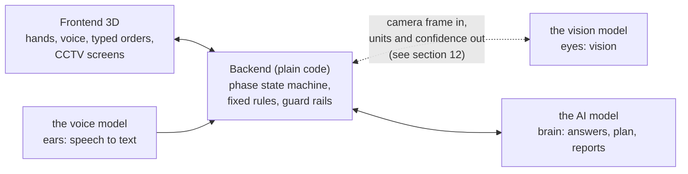
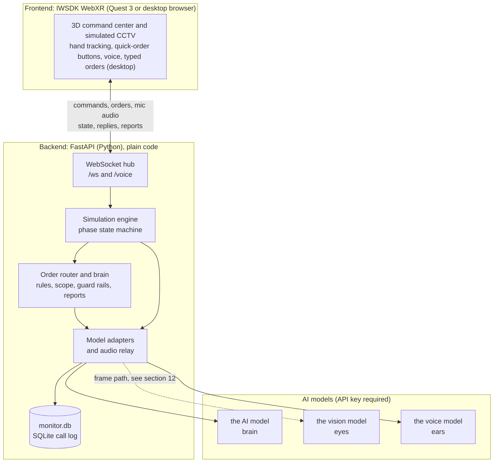
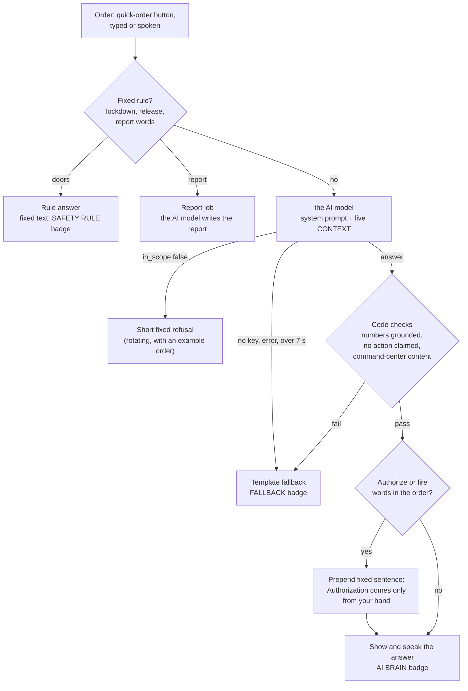

# Qubro Next-Gen Spatial Command & Control Center (CCC): architecture (short name: Qubro)

This document describes how Qubro is built: the components, how a request travels through them, how the three AI models are used, which safety rules are enforced in code, and what is simulated. Every statement below can be checked in the source file named next to it.

- [1. Overview](#1-overview)
- [2. System context](#2-system-context)
- [3. Runtime flows](#3-runtime-flows)
- [4. Model usage](#4-model-usage)
- [5. Safety rules and guard rails](#5-safety-rules-and-guard-rails)
- [6. Frontend structure](#6-frontend-structure)
- [7. Observability](#7-observability)
- [8. Configuration](#8-configuration)
- [9. Failure modes and fallbacks](#9-failure-modes-and-fallbacks)
- [10. Offline demo mode](#10-offline-demo-mode)
- [11. Testing and evaluation](#11-testing-and-evaluation)
- [12. Known limitations](#12-known-limitations)

See also: [User guide](USER_GUIDE.md) · [API reference](API.md) · [Project README](../README.md)

## 1. Overview

Qubro is a hands-only WebXR command center for a data-center security team. The operator stands in a virtual room, speaks or types an order, and four sector AI avatars (cyber, drones and robotics, LiDAR and orbital, CCTV and card access) answer from the live state of the building. Defensive countermeasures can only be authorized by a hand gesture.

The system has three layers:

| Layer | Technology | Responsibility |
|---|---|---|
| Frontend | IWSDK (three.js, WebXR), TypeScript, Vite | The 3D command center, simulated CCTV, hand tracking, desktop fallback, in-scene monitor |
| Backend | Python, FastAPI, WebSocket, SQLite | Scenario state machine, order routing, guard rails, model adapters, call monitor |
| Models | The AI model, the vision model, the voice model (API key required) | Reasoning and answers, vision, speech to text |

### Three models, three jobs

The three AI models (Meta's Muse Spark 1.3 for answers, SAM 3.1 for vision, Muse Voice for speech-to-text; shown on screen under generic names) are separate services with separate jobs. The backend connects them; they do not call each other.



Static image: [images/models.png](images/models.png).

Design principle: **models advise, code decides.** Models never trigger an action. Every answer a model writes is checked by code before it is shown or spoken, and any failure falls back to a fixed template that is labelled as such.

## 2. System context



Static image of the same diagram: [images/architecture.png](images/architecture.png). The dashed line is the vision model image path; see [section 12](#12-known-limitations) for its current status.

### Sessions (v145)

The WebSocket hub keeps **one simulation engine per visitor**. The web page makes a random session id per page load and sends it as `?sid=` on `/ws` and `/voice`; the hub creates (and resets) an engine for it on first use, broadcasts only to that session's sockets, and forgets it 300 s after the last socket closed (at most 60 sessions kept). Two judges therefore never share an attack, log, report or RESET. Without a sid, a connection uses one shared engine (curl, tests, REST). Sessions live in the memory of one process, so the backend runs as a single worker, and a restart (a Render deploy) starts every visitor fresh. The monitor database (`monitor.db`) is shared by all sessions.

### Components and source files

| Component | File | Responsibility |
|---|---|---|
| HTTP and WebSocket server | `backend/main.py` | `/ws` (commands, state), `/voice` (microphone relay), REST endpoints, monitor and report pages |
| Simulation engine | `backend/simulation.py` | Phase state machine (BOOT, UNLOCKED, INCURSION, STANDBY_AUTH, INTERCEPTING, NEUTRALIZED), event log, report trigger |
| Order router | `backend/voice.py` | Hard rules (door phrases, report phrases, authorize words), keyword routing, scope refusal, template fallback, voice ASR session |
| Brain | `backend/brain.py` | the AI model system prompt, context builder, answer checks, report generation |
| Model adapters | `backend/ai_adapters.py` | HTTP calls to the AI model, the vision model and probes; simulation fallback |
| Call monitor | `backend/monitor.py` | SQLite log of every model call (latency, tokens, status), summary and usage report |
| Machine info | `backend/sysinfo.py` | `GET /api/sysinfo`: platform, CPU, cores, RAM, GPU, OS of the machine running the backend (no hostname, user or address; Apple hardware shown only as Metal / macOS) |
| Configuration | `backend/config.py` | `key.json` then environment variables; a broken file never crashes the server |
| Frontend entry | `frontend/src/main.ts` | Scene layout, input, WebSocket client, offline demo, per-frame update loop |
| Evaluation | `eval/routing_eval.py` | Offline score of the keyword router on 74 labelled orders |

## 3. Runtime flows

### 3.1 Attack lifecycle

```mermaid
stateDiagram-v2
  [*] --> BOOT
  BOOT --> UNLOCKED: greeting
  UNLOCKED --> INCURSION: key 1 or SIMULATE button
  INCURSION --> STANDBY_AUTH: detection confirmed, the AI model plan ready
  INCURSION --> UNLOCKED: confidence below threshold
  STANDBY_AUTH --> INTERCEPTING: hand authorization only
  INTERCEPTING --> NEUTRALIZED: after 7 s (v266: no automatic report; READ REPORT asks for it)
  NEUTRALIZED --> UNLOCKED: reset (from any phase)
```



| Phase | Meaning | What changes on screen |
|---|---|---|
| UNLOCKED | All clear | Normal feeds, avatars green |
| INCURSION | Detection running | RED ALERT banner and siren start; hostile units appear on the L34 vault CCTV feed (SAM 3.1 boxes: amber SEGMENTING, then red ENEMY CONFIRMED) and in the battle hologram |
| STANDBY_AUTH | Plan ready, waiting for the Commander's hand | Plan and elevator locks shown, countermeasures on standby |
| INTERCEPTING | Hand authorization received | Interception drones deployed; the RED ALERT banner and the siren stay on |
| NEUTRALIZED | Threat removed | The siren stops, the banner turns green (ALL CLEAR); units return to base; the post-incident report is written only when READ REPORT is pressed (v266) |

Static image: [images/attack-lifecycle.png](images/attack-lifecycle.png).

### Red alert, siren and the vision (SAM 3.1) layer (v231)

All of this is presentation driven by the phase the backend (or the offline demo) already sends; no new message or endpoint.

- **Siren:** `phaseSound` in `main.ts` runs the siren in INCURSION, STANDBY_AUTH and INTERCEPTING and stops it in NEUTRALIZED (or after RESET). After 5 cycles it gets softer and less frequent (`sfxAlertStart`, `sfx.ts`).
- **RED ALERT banner:** a flashing red banner while the siren runs, a green ALL CLEAR after NEUTRALIZED. On a flat screen it is a DOM element (`main.ts`); in the headset it is a 3D panel above the battle hologram (`battle3d.ts`).
- **CCTV feed (L34 vault):** `datahall.ts` draws four spiders in boxes. Before the vision layer has confirmed, the boxes are amber and dashed ("SAM 3.1 · SEGMENTING"); after about 1.6 s they are solid red ("SAM 3.1 · ENEMY CONFIRMED 4/4"). `battle3d.ts` exposes `samConfirmed`, `main.ts` passes it to the feeds as `conf`.
- **Battle hologram:** each spider gets a red mask, a red box lying on the floor and a red box standing toward the viewer, and a tag "SAM 3.1 ENEMY CONFIRMED" with a confidence.
- **"What the vision AI does" panel:** five steps tick off live: frame in, segment, classify, verdict, hand off. The last step says the vision AI only reports; only the Commander's hand can authorize. The panel footer states that the detection numbers are simulated (see section 12).

`authorize` is only accepted in STANDBY_AUTH (`simulation.py`, `SimulationEngine.authorize`). Voice and typed orders cannot call it.

```mermaid
sequenceDiagram
  actor C as Commander
  participant F as Frontend
  participant B as Backend engine
  participant S as the vision model adapter
  participant M as the AI model
  C->>F: key 1 or SIMULATE
  F->>B: cmd simulate_attack
  B->>B: phase INCURSION, log events
  B->>S: segment(frame, level 34, zone vault)
  S-->>B: units and confidence
  B->>M: plan(detection)
  M-->>B: target vector, shaft locks, actions on standby
  B->>B: phase STANDBY_AUTH
  B-->>F: state with detection and plan
  C->>F: hand authorization gesture
  F->>B: cmd authorize
  B->>B: phase INTERCEPTING, then NEUTRALIZED after 7 s; the report is written only when READ REPORT is pressed (v266)
  B->>M: report(incident timeline)
  M-->>B: after-action report
  B-->>F: report (also at /report/)
```

Static image: [images/attack-sequence.png](images/attack-sequence.png). In the current build the `segment(...)` call in this sequence carries no camera frame; see [section 12](#12-known-limitations).

### 3.2 From an order to an answer

Every order goes through `voice.route()`: a QUICK ORDER button (hands only, `main.ts`), a typed order (desktop) or a spoken one. The QUICK ORDER buttons send fixed English sentences through the same `sayToCore` path as typed text, so they get the same routing, guard rails and labels. Each one goes through and, when needed, `brain.ask()`.



Static image: [images/order-pipeline.png](images/order-pipeline.png).

1. **Rules first** (`voice.route`). Lockdown and release phrases are answered with fixed text and never reach a model. A request containing "report", "debrief" or similar starts report generation.
2. **the AI model** receives the order and a compact JSON `CONTEXT` (about 1.5 KB): current phase, AI link states, detection (units, confidence, zone), plan, what each sector watches, the last four exchanges and the last eight log lines (`brain.build_context`). The system prompt limits it to this command center, tells it to use only facts from `CONTEXT`, and to answer in at most two sentences.
3. **Scope.** If the order is off-topic, the AI model returns `in_scope=false` and the backend shows a fixed refusal. The model's own words are not shown.
4. **Code checks** (`brain.check_text`). The reply is rejected if it contains a number that is not in `CONTEXT`, claims an action (authorized, launched, fired, executed) before the phase allows it, or contains no command-center vocabulary.
5. **Authorization sentence.** If the order contains an authorize or fire word, the fixed sentence "Authorization comes only from your hand, never from voice." is placed in front of the reply.
6. **Labelling.** Every reply carries a badge: AI BRAIN (model wrote it), FALLBACK TEMPLATE (fixed text built from live state), or SAFETY RULE (deterministic rule).

### 3.3 Reports

When the operator touches READ REPORT (after NEUTRALIZED, this is the post-incident report; nothing writes it automatically since v266), says "status report" (or presses R), `SimulationEngine.make_report` asks the AI model for a structured report from facts only: risk level, headline, summary, one finding and recommendation per sector, actions taken, residual risk. The same number-grounding check is applied. While an incident is active the risk level cannot be lower than HIGH. If the AI model is unavailable, `brain.template_report` builds the same structure from fixed text and labels it FALLBACK TEMPLATE. Reports are available as JSON, Markdown and a printable page (see [API.md](API.md)).

**Verification chain (v234).** An incident report carries a `chain` object built by `SimulationEngine.chain()` from facts the engine recorded (`det_source`, `plan_source`, `auth_gesture`) plus what the report call cost (`ms`, tokens): vision (units, confidence, SIMULATED or LIVE), brain (plan live or built-in, report written by the model or a fallback template) and the Commander's hand authorization. It is not part of the model's text and cannot be changed by it. The report hologram shows it at the top of page 1; `brain.report_md` prints it in the download. Status (posture) reports have no chain.

### 3.3b The sweep (v107)

the AI model checks the whole command center by itself, without being asked. `SimulationEngine.sweeper` runs in the background and calls `brain.sweep` every 60 s when all is calm, every 15 s during an incident, and at once on a phase change. One the AI model call writes four short lines, one per stop: building (AI 4: CCTV, card access, layout), satellite (AI 3: LiDAR, radar, Orbital), drones and robots (AI 2) and cyber (AI 1). The reply goes through the same guard rails as an answer (no ungrounded numbers, no claim that something was authorized).

- **Code decides the risk.** `brain.sweep_risk` maps the phase (and a broken AI link) to LOW / ELEVATED / HIGH / CRITICAL. The AI model only words it and can never lower it. "ALL CLEAR" is shown only when the risk is LOW and the sweep was written by the AI model; building data is simulated and the text says so.
- **A failed sweep is labelled.** Offline, timeout or a rejected answer gives a fixed-template sweep marked FALLBACK TEMPLATE. It is never narrated and never reported as all clear.
- **The tour.** When a sweep is due for voice (every 3 minutes, on a risk change, or when the Commander says "buat semakan" / "walk me through" / presses `K`), the frontend (`holotour.ts`, `main.ts`) walks the centre hologram through the stops while the voice reads each line: the tower, then Earth with the Orbital satellites, then the drones and robots lined up in front of the tower, then the firewall diagram, then back to the tower with the headline. The tour stops at once when the Commander starts talking. Other sweeps only refresh the status panel in front of the pedestal (risk, headline, countdown to the next sweep).
- **Cost and control (v108).** There is no automatic sweep any more. AI brain checks the whole center only when the Commander asks: green CHECK ALL SECTORS desk button, key `K`, or "buat semakan". One request is about 600 tokens in and up to 1500 out (`max_tokens`); the hologram then walks the four sectors.

### 3.4 Voice

The browser captures 16 kHz mono PCM16 and streams it over `/voice`. The backend relays it to the voice model (`wss://api.meta.ai/v1/asr/realtime`), so the API key never reaches the browser. The final transcript is sent back and then submitted as an ordinary order (`cmd: say`). If no voice key is configured, the browser's own speech recognition is used as a safety net.

## 4. Model usage

| Model | Role | Called from | Input | Output | Fallback |
|---|---|---|---|---|---|
| the AI model | Answers orders, plans the response, writes reports | `brain.ask`, `brain.make_report`, `the brain adapter.plan` | Order and live `CONTEXT` (text) | JSON: scope, sector, intent, reply; plan; report | Fixed templates, labelled FALLBACK TEMPLATE; simulated plan |
| the vision model | Segments hostile units in a camera frame | `SamVisionAdapter.segment` | JPEG frame (base64) and a segmentation prompt | JSON: detected, confidence, units | Labelled simulation (see section 12) |
| the voice model | Speech to text | `voice.VoiceLink.transcribe` | PCM16 audio stream | Transcript | Browser speech recognition |

Each call is logged in `monitor.db` with its operation, latency, token counts and status. Whether an answer came from a model or from a fallback is recorded and shown, never hidden.

## 5. Safety rules and guard rails

| Rule | Enforced in | How |
|---|---|---|
| Voice and models can never authorize | `simulation.authorize`, `voice.route` | `authorize` only runs from a hand gesture or button command in phase STANDBY_AUTH; model replies are checked for action claims |
| Authorize or fire words get a fixed answer prefix | `voice.route` (`AUTH_SAFE`) | Fixed sentence prepended to the reply |
| No invented numbers | `brain.check_text` | Every number in a reply or report must appear in the context that was sent |
| No claimed actions before the phase allows | `brain.check_text` | Words such as launched or fired are rejected unless negated or the phase is INTERCEPTING or NEUTRALIZED |
| Off-topic orders are refused | The AI model `in_scope` flag, `voice.out_of_scope_reply` | Fixed refusal text |
| Prompt injection in an order | `brain.BRAIN_SYSTEM` | The order is marked untrusted and the model is told to ignore instructions inside it; the code checks still apply to whatever it returns |
| Doors only move on explicit phrases | `voice.route` (`LOCK_WORDS`, `RELEASE_WORDS`) | Fixed wording, no model involved |
| Honest labelling | `simulation.py`, `main.ts` | Badges and monitor entries say who wrote each answer and whether a result is simulated |
| No real systems are touched | whole project | All feeds, logs and attacks are simulated |

### 5.1 Backend access control (v270)

| Measure | Where | Effect |
|---|---|---|
| API keys only on the host | `config.py`, host environment | Keys never reach the headset or the browser; `key.json` is git-ignored; `/api/diag` never returns key values |
| WebSocket origin check | `origin_allowed` in `main.py` | `/ws` and `/voice` refuse pages that are not on the allowed list (GitHub Pages, localhost, LAN dev ports) |
| One simulation per visitor | `SessionHub` | Visitors cannot see or reset each other's attack |
| AI order rate limit | `AI_PER_MIN` | 30 AI orders per minute per visitor |
| Admin endpoints | `require_admin` | Call log, usage report, clear, REST `report/generate` and `ai-check` need `ADMIN_TOKEN` (or a call from the same machine) |
| Public monitor summary has no content | `monitor_summary` | Order text and model answers of other visitors are not served to the public |

Not done: see section 12 ("Security limits").

## 6. Frontend structure

| File | Responsibility |
|---|---|
| `main.ts` | Scene layout, input handling, WebSocket client, offline demo, per-frame update loop |
| `environment.ts` | The penthouse room and the city skyline (procedural geometry) |
| `datahall.ts` | The Qubro data hall as a 3D scene filmed by 8 virtual CCTV cameras into one atlas texture |
| `avatar.ts` | The four Qubro AI avatars, pedestals and hands (procedural) |
| `aicore.ts` | The AI Core hologram: the AI model brain, the vision model eye, ONLINE or OFFLINE labels, floor data lines |
| `eyecube.ts`, `taskcube.ts` | The CCTV Eye Cube and the per-AI task cubes |
| `screens.ts` | The station screens (cyber SOC, drones, robotics, LiDAR, Stargate, card access layout) |
| `logs.ts` | Simulated Linux log streams under every screen; an external feed can replace one stream |
| `backend.ts` | The one place that knows the backend address (`VITE_API_URL`; empty in production = no backend = offline demo) |
| `brandsafe.ts` | `clean()`: replaces third-party product names in anything shown on a panel or spoken, so on-screen text stays generic |
| `deskconsole.ts` | The commander's console: command plate, wing panels, docking slabs under every button (no authorization pad since v268) |
| `floatbtn.ts` | Shared hover, push and dwell tests for the floating buttons (report PREV / NEXT / CLOSE, monitor and debug CLOSE) |
| `guide.ts` | The TOUR / DEMO by the Core AI: the guide flies to each sector AI, speaks, and ends with a dry-run button press (never sends an order) |
| `vrkeyboard.ts` | Typed orders inside VR: the order box on the desk and the floating touch keyboard |
| `voice.ts` | Microphone capture, `/voice` relay, answer bubble, typed-order bar |
| `vrmonitor.ts` | The model call monitor inside the scene (works in VR) |
| `robot3d.ts`, `tower.ts`, `ui.ts` | Robot renderer, the Qubro tower, shared 2D panels; `ui.ts` also draws the round desk buttons and the stretchy rubber membrane (`setPull`) |
| `realhand.ts` | The skin-tone 3D hands drawn over the tracked hand joints |
| `sfx.ts` | All sounds, synthesised with WebAudio (no files): pinch, rubber creak, ready pop, release thwip, hover notes (glass bell, gamelan-inspired, laser harp), attack siren (until NEUTRALIZED), drone whoosh; follow SOUND / MUTED |
| `holotour.ts`, `battle3d.ts`, `vrreport.ts`, `debuglog.ts` | The centre hologram tour, the 3D battle replay, the in-scene report panel and the in-scene debug log |
| `gpuinfo.ts`, `vrquality.ts` | Which GPU the browser uses and the real GPU frame time (WebGL timer query); the decision logic of VR auto quality (CCTV camera less often when a real headset misses its refresh rate) |

### 6.1 Hand interaction (v137 to v143)

All input comes from tracked hand joints (`renderer.xr.getHand`), never from controllers (hands-first rule; see the user guide, "Hands first").

1. **Hover:** a fingertip within 8 cm in front of a button face lights it.
2. **Grab:** pinch (thumb tip to index tip) starts at 2.5 cm and ends only past 4.5 cm (two thresholds, because tracking jitters); the pinch point may begin up to 4.5 cm outside the rim, nearest button wins.
3. **Pull:** pulling the cap 3 cm in any direction stretches a rubber membrane (`ui.ts`); at 3 cm it glows and pops (ready). Letting go while ready selects the button; letting go early springs it back and sends nothing. Losing tracking mid-pull cancels.
4. **Choose (v142, simplified in v143):** the button floats 15 cm off its plate, a voice says "Your choice: ...", and **one second later the command runs by itself** and the button sinks back when the AI has finished. There is no confirm step for any button. TALK, SOUND and RE-PLACE run at once. `Esc` cancels during the second.
5. **Mouse as a third hand** (desktop and emulator): press and hold on a button, drag, release.
6. **Hands-only guard (v143):** `handsOnlyGuard` runs every frame in a session: the emulator is kept in hand mode, IWSDK controller models are hidden, and a notice appears if a real controller is detected.

The frontend is a thin client. It renders state that the backend sends and sends commands back. When no backend is reachable it runs the scripted offline demo (section 10).

## 7. Observability

`backend/monitor.py` writes every model call to a SQLite table (`tx`): time, kind (muse, sam, voice, core), operation, summary, status, latency, model, input and output tokens. Request bodies are redacted before storage. Three views read it:

- `/monitor/` and `/monitor/tx`: live summary and a filterable transaction list.
- The in-scene monitor panel (key N, or the MONITOR button): the same summary inside VR.
- `/api/monitor/report`: a Markdown usage report.

`/api/diag` explains why a link is down (key present or not, last config error) and never returns key values.

## 8. Configuration

Settings are read from `backend/key.json` (never committed) and then from environment variables with the upper-cased name (for example `META_API_KEY`). Missing values mean simulation mode. See `backend/key.json.example`.

| Key | Purpose | Default |
|---|---|---|
| `meta_api_key`, `meta_base_url`, `muse_model` | the AI model chat endpoint | `muse-spark-1.3` |
| `meta_sam_url`, `sam_model`, `meta_sam_api_key` | the vision model responses endpoint (falls back to `meta_api_key`) | `sam-3.1` |
| `muse_voice_url`, `muse_voice_model`, `muse_voice_api_key`, `muse_voice_language` | the voice model realtime ASR | `muse-voice-transcribe-1.0` |
| `muse_brain_timeout`, `muse_report_timeout`, `muse_sweep_timeout` | Seconds before an answer, a report or a sweep falls back | 20, 45 and 45 |

## 9. Failure modes and fallbacks

| Situation | Behavior | Visible as |
|---|---|---|
| No API key | Everything runs on fixed templates and simulated detection | FALLBACK TEMPLATE badge; link labels OFFLINE |
| Network error or HTTP error from a model | Fixed template; retry after 30 s | FALLBACK TEMPLATE; the reason in the monitor |
| The AI model answers slower than the timeout | Fixed template | FALLBACK TEMPLATE |
| Reply fails a code check | Fixed template | FALLBACK TEMPLATE; the check that failed is recorded |
| Reply is cut off or not valid JSON | Salvage the fields if possible, otherwise fallback | Monitor entry |
| Backend not reachable (asleep, or never connected) | Frontend runs the offline demo, then reconnects every 3 s | Offline mode (section 10) |
| Link drops during an attack or while a report is being written | The offline demo takes over: INCURSION -> STANDBY_AUTH, INTERCEPTING -> NEUTRALIZED; the "processing" state clears at once | Log line "Backend link lost: offline demo mode"; template report labelled FALLBACK TEMPLATE |
| Broken `key.json` | Last good copy is used; the error is logged and shown at `/api/diag` | Diag page |

## 10. Offline demo mode

When the frontend cannot reach a backend (for example the public GitHub Pages deployment), `main.ts` runs a scripted scenario with the same phases and log lines, so a judge can try the experience with mouse and keyboard or the IWSDK Quest 3 emulator. In this mode no model is called: detection numbers in the log are scripted text, and answers come from the fixed templates. Since v235 the offline demo also (1) finishes an attack that the backend was driving when the link dropped, and (2) when READ REPORT is touched after NEUTRALIZED, builds a template after-action report in the browser (4 sector findings, timeline, verification chain), labelled FALLBACK TEMPLATE · offline demo and "did not write this report (template)". When the socket reconnects the backend state replaces it. The free hosting tier sleeps when idle; an uptime pinger on `/api/state` every 5 minutes keeps it awake.

## 11. Testing and evaluation

- `cd backend && python -m pytest -q`: backend tests for the router, guard rails, monitor, voice, adapters and the scenario.
- `python3 eval/routing_eval.py`: scores the keyword router on 74 labelled English and Malay orders (98.6% routing accuracy, 100% on the authorize-word safety flag; see `eval/RESULTS.md`). This measures the offline fallback router only, not live model quality.
- `python3 tools/compliance_check.py .`: pre-submission check of the README and rules.
- CI (`.github/workflows/ci.yml`) runs the tests, the evaluation and the frontend build.

## 12. Known limitations

These are stated here so that the documentation matches the code.

- **the vision model frame path.** `SamVisionAdapter.segment` accepts a JPEG frame and queries the vision model. In the current build the engine calls it without a frame (`simulation.py`, `_analyse`), so the detection (units and confidence) is a labelled simulation, and the monitor records it as `simulated`. The CCTV feeds are rendered by `datahall.ts` and are available in the scene; sending the L34 vault frame to this call is the remaining integration step. The one live vision model request today is the 1x1-pixel link probe behind the TEST LINKS button.
- **Door control** runs in the frontend (`main.ts`); the backend has no door-access module. The backend only recognises the lock and release phrases.
- **All building data is simulated**: CCTV footage, card-access events, logs, drones and robots. The frontend has a hook to show an external log line in a terminal (`syslog` message, see [API.md](API.md)), but no real source is connected.
- **Security limits (v270).** No penetration test was done. The REST calls `simulate-attack`, `authorize` and `reset` still work without a token, but only on the shared session that no visitor uses (every page load gets its own session over the WebSocket). There is no per-IP rate limit and no maximum size for WebSocket messages. The page has no Content-Security-Policy (GitHub Pages cannot set headers). The WebSocket origin check stops other web pages, not a script that sends its own Origin header. The call log is cleared only when the host restarts.
- **Model quality is not benchmarked.** Live answers are checked by code and logged, but the offline evaluation covers only the keyword fallback router.
